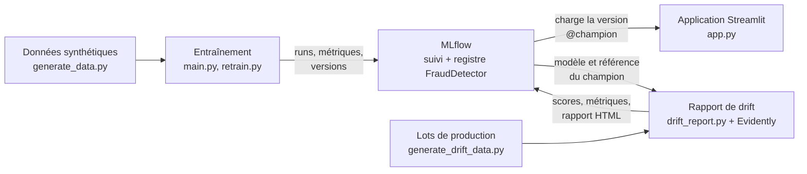

# Détection de fraude : gouverner et surveiller un modèle en production

Démo pédagogique de NDA, construite pour deux sessions du Tech Radar, autour d'un même cas : une banque qui détecte la fraude sur ses paiements par carte.

1. **Gouverner un modèle avec MLflow** : tracer les entraînements, versionner les modèles, et promouvoir le bon modèle en production sans redéployer l'application.
2. **Surveiller un modèle avec Evidently** : savoir si le modèle fonctionne encore, alors que ses erreurs ne sont connues que des semaines plus tard, puis décider s'il faut le réentraîner.

Les données sont synthétiques, et c'est voulu : chaque scénario de la démo isole une seule cause de changement, ce qui serait impossible avec des données réelles.

---

## Sommaire

1. [Le projet en bref](#1-le-projet-en-bref)
2. [Contenu du dépôt](#2-contenu-du-dépôt)
3. [Installation](#3-installation)
4. [Démarrer MLflow et l'application](#4-démarrer-mlflow-et-lapplication)
5. [Partie 1 : gouverner un modèle](#5-partie-1--gouverner-un-modèle)
6. [Partie 2 : surveiller le drift, scénario par scénario](#6-partie-2--surveiller-le-drift-scénario-par-scénario)
7. [Partie 3 : réentraîner, comparer, promouvoir, revenir en arrière](#7-partie-3--réentraîner-comparer-promouvoir-revenir-en-arrière)
8. [Rejouer toute la démo d'un coup](#8-rejouer-toute-la-démo-dun-coup)
9. [Repartir de zéro](#9-repartir-de-zéro)
10. [Déployer ailleurs qu'en local](#10-déployer-ailleurs-quen-local)
11. [Limites de la démo](#11-limites-de-la-démo)
12. [Dépannage](#12-dépannage)

---

## 1. Le projet en bref

### Le cas

Chaque paiement est décrit par huit variables, toutes connues au moment du paiement :

| Variable | Signification |
|---|---|
| `amount` | montant de la transaction |
| `hour` | heure de la transaction |
| `distance_from_home_km` | distance entre le lieu du paiement et le domicile |
| `is_new_device` | paiement depuis un appareil jamais vu pour ce client |
| `is_foreign_country` | paiement dans un pays étranger |
| `transactions_last_24h` | nombre de transactions du client sur 24 heures |
| `avg_amount_last_30d` | montant moyen du client sur 30 jours |
| `amount_to_avg_ratio` | rapport entre le montant et cette moyenne |

Une fraude réunit trois indices à la fois, par exemple un nouvel appareil, un pays étranger et un montant inhabituel. Un indice seul ne suffit jamais. Comme dans la réalité, 4 % des fraudes ne sont jamais signalées et restent étiquetées « légitimes ».

Le jeu d'entraînement compte 60 000 transactions, dont 0,65 % de fraudes et seulement 0,5 % de paiements à l'étranger.

### L'architecture



- **MLflow** enregistre chaque entraînement, range chaque modèle comme une version du registre `FraudDetector`, et désigne la version en production par l'alias `@champion`.
- **L'application** sert toujours la version qui porte `@champion` : changer de modèle revient à déplacer l'alias.
- **Evidently** compare chaque lot de production aux données de référence du modèle en production, et range son rapport dans MLflow.

---

## 2. Contenu du dépôt

```
fraud-detection-mlops/
├── app.py                        # application Streamlit de scoring
├── main.py                       # entraîne la v1 et la v2, met la v1 en production
├── requirements.txt              # dépendances, versions figées
├── frauddetection/               # code du pipeline d'entraînement
│   ├── components/               # ingestion des données, entraînement
│   ├── constants/                # noms, chemins, seuils (tout est centralisé ici)
│   ├── pipeline/                 # orchestration de l'entraînement
│   └── utils/                    # métriques, référence versionnée du drift
├── scripts/
│   ├── generate_data.py          # génère le jeu d'entraînement (60 000 transactions)
│   ├── generate_drift_data.py    # génère les lots de production des scénarios
│   ├── drift_report.py           # rapport de drift et de performance sur un lot
│   ├── retrain.py                # entraîne un challenger sur un lot récent
│   ├── compare_models.py         # compare le champion et le challenger
│   ├── promote_model.py          # déplace l'alias @champion (promotion, rollback)
│   ├── run_demo_local.ps1        # rejoue toute la démo (Windows)
│   └── patch_mlflow_ui.py        # corrige un bug de l'interface MLflow sur les alias
├── fraud_data/                   # données générées
├── gcp/                          # déploiement sur Google Cloud (voir gcp/DEMO.md)
├── docker-compose.yml            # déploiement Docker (MLflow, application, nginx)
└── notebooks/demo_mlflow.ipynb   # déroulé pas à pas de la partie 1
```

Les dossiers `artifacts/`, `reports/`, `mlartifacts/` et le fichier `mlflow.db` sont créés à l'exécution et ignorés par Git.

---

## 3. Installation

**Prérequis** : Python 3.11 (la version utilisée par la CI et les images Docker) et Git.

```bash
git clone https://github.com/valeriepatu9/fraud-detection-mlops.git
cd fraud-detection-mlops
python -m venv venv
```

Activer l'environnement virtuel, selon votre terminal :

| Terminal | Commande |
|---|---|
| PowerShell | `.\venv\Scripts\Activate.ps1` |
| Git Bash | `source venv/Scripts/activate` |
| macOS, Linux | `source venv/bin/activate` |

Puis installer les dépendances et corriger l'interface MLflow :

```bash
pip install -r requirements.txt
python scripts/patch_mlflow_ui.py
```

Le second script corrige un bug de l'interface de MLflow 3 lors de la modification d'un alias. Il est à relancer après chaque réinstallation de MLflow.

Toutes les commandes de ce README se lancent **à la racine du projet, environnement virtuel activé**.

---

## 4. Démarrer MLflow et l'application

Ouvrir deux terminaux, à laisser ouverts pendant toute la démo.

**Terminal 1 : le serveur MLflow**

```bash
python -m mlflow server --backend-store-uri sqlite:///mlflow.db --default-artifact-root ./mlartifacts --host 127.0.0.1 --port 5000 --workers 1
```

L'interface est disponible sur http://127.0.0.1:5000.

**Terminal 2 : l'application**, une fois qu'une version porte l'alias `@champion` (voir la partie 1)

```bash
python -m streamlit run app.py
```

L'application est disponible sur http://localhost:8501.

Les scripts et l'application visent par défaut le serveur MLflow local. Pour en viser un autre, définir la variable d'environnement `MLFLOW_TRACKING_URI`.

---

## 5. Partie 1 : gouverner un modèle

**Le message** : un modèle peut afficher 99 % de bonnes réponses sans détecter une seule fraude. MLflow rend ce piège visible, et permet de remplacer le modèle sans toucher à l'application.

Dans un troisième terminal :

```bash
python scripts/generate_data.py
python main.py
```

Le premier script génère les 60 000 transactions. Le second entraîne deux modèles, les enregistre dans MLflow, et met la v1 en production :

| Version | Modèle | Accuracy | Recall | Précision |
|---|---|---|---|---|
| v1 | Decision Tree de profondeur 2 | 99,35 % | 0 | aucune alerte |
| v2 | Random Forest, classes rééquilibrées | 99,93 % | **0,91** | 0,98 |

Avec 0,65 % de fraudes, un modèle qui répond toujours « légitime » a déjà 99,35 % de bonnes réponses. On suit donc le **recall**, la part des fraudes détectées, et la **précision**, la part des alertes justifiées.

**À tester dans l'application** : lancer l'application (section 4), puis cliquer sur « Transaction suspecte » (4 200 € depuis Varsovie, à 2 h, sur un appareil inconnu). Avec la v1, le score vaut environ 0,26 : la fraude passe.

**Promouvoir la v2**, au choix :
- dans MLflow : Models, `FraudDetector`, Version 2, Aliases, ajouter `champion` ;
- ou en ligne de commande : `python scripts/promote_model.py 2`.

Dans l'application, cliquer sur « ↻ Recharger le modèle » : le badge passe à la v2, et la même transaction est bloquée, avec un score d'environ 0,69.

---

## 6. Partie 2 : surveiller le drift, scénario par scénario

**Le message** : le recall d'un modèle en production n'est connu qu'à l'arrivée des labels, quand les clients contestent leurs paiements, un à trois mois plus tard. En attendant, on ne peut mesurer qu'une chose : le changement des données d'entrée, le data drift. Or un drift n'implique pas forcément une dégradation, et une dégradation peut survenir sans aucun drift.

Avant de commencer, vérifier que l'alias `@champion` est sur la v2 (partie 1).

### 6.1 Deux notions

- **Data drift** : la distribution des variables d'entrée en production s'écarte de celle de l'entraînement, alors que le lien entre ces variables et la fraude reste le même.
- **Concept drift** : le lien entre les variables et la fraude change. Une même transaction ne veut plus dire la même chose. Il ne se voit qu'avec les labels.

### 6.2 Générer les lots de production

```bash
python scripts/generate_drift_data.py
```

Le script crée, dans `fraud_data/`, un lot de 15 000 transactions par scénario. Dans chaque lot, une seule chose change par rapport aux données d'entraînement :

| Lot | Scénario | Ce qui change | Taux de fraude |
|---|---|---|---|
| `prod_normal` | Période normale | rien | 0,72 % |
| `prod_premium` | Clientèle plus aisée | 30 % de gros clients au lieu de 10 % | 0,61 % |
| `prod_foreign_card` | Carte sans frais à l'étranger | 15 % de paiements à l'étranger au lieu de 0,5 % | 1,46 % |
| `prod_card_testing` | Card testing | des rafales de petits paiements, autrefois légitimes, deviennent de la fraude | 2,05 % |
| `prod_black_friday` | Cas complémentaire | les achats légitimes sont 60 % plus élevés | 0,61 % |

Les lots `prod_foreign_card_next` et `prod_card_testing_next` représentent **le mois suivant**. Ils servent à juger un modèle réentraîné sur des données qu'il n'a jamais vues (partie 3).

Le taux de fraude augmente dans deux lots, pour deux raisons différentes. Avec la carte à l'étranger, les règles de la fraude ne changent pas, mais les paiements à l'étranger, plus souvent frauduleux, deviennent bien plus nombreux. Avec le card testing, ce sont les règles qui changent.

### 6.3 Lancer un rapport de drift

```bash
python scripts/drift_report.py <nom_du_lot>
```

Le script compare le lot aux **données de référence du champion**, c'est-à-dire au jeu de test sur lequel ce modèle a été évalué. Cette référence est enregistrée avec chaque version du modèle, et son empreinte est vérifiée avant chaque rapport.

Comptez 30 à 40 secondes par rapport. Le premier appel crée l'expérience MLflow `fraud_drift_monitoring`.

**Ce que le terminal affiche**

- **Bloc [A], disponible tout de suite, sans labels** : pour chaque variable, la méthode de mesure, le score de drift, le seuil et le verdict ; le nombre de variables en drift ; le verdict global d'Evidently ; le taux d'alertes du modèle, c'est-à-dire la part de transactions qu'il bloque.
- **Bloc [B], disponible à l'arrivée des labels** : le taux de fraude, le recall, la précision et le F1, en global, en France et à l'étranger. Une tranche qui compte moins de 30 fraudes est marquée `FRAGILE` : ses chiffres ne permettent aucune conclusion.

Dans la démo, les deux blocs s'affichent en même temps parce que les labels des données synthétiques sont déjà connus. En réalité, le bloc [B] n'arriverait qu'un à trois mois plus tard.

**Où retrouver les résultats**

- dans MLflow, expérience `fraud_drift_monitoring`, un run par lot, nommé `<lot>__v<version du champion>` ;
- le rapport Evidently, dans les artefacts du run (dossier `evidently`) et dans `reports/drift_<lot>.html`.

**Comment Evidently mesure le drift** : jusqu'à 1 000 lignes, il utilise des tests statistiques avec une p-value ; au-delà, des distances. Avec des lots de 15 000 transactions, la démo utilise donc la distance de Wasserstein pour les variables continues et la distance de Jensen-Shannon pour les variables oui/non. Une variable est en drift si son score dépasse 0,1. Le verdict global ne signale un drift qu'à partir de la moitié des variables, soit 4 sur 8.

### 6.4 Les quatre scénarios

Lancer les quatre rapports :

```bash
python scripts/drift_report.py prod_normal
python scripts/drift_report.py prod_premium
python scripts/drift_report.py prod_foreign_card
python scripts/drift_report.py prod_card_testing
```

Résultats attendus avec la v2 en production (référence : 0,61 % d'alertes, recall de 0,908) :

| Scénario | Bloc [A] : variables en drift | Bloc [A] : taux d'alertes | Bloc [B] : recall | Ce qu'il faut retenir |
|---|---|---|---|---|
| Période normale | 0 sur 8 | 0,71 % | 0,944 | rien ne bouge : c'est le témoin |
| Clientèle plus aisée | 2 sur 8 : `amount`, `avg_amount_last_30d` | 0,59 % | 0,935 | le drift sonne, mais le modèle tient |
| Carte à l'étranger | 1 sur 8 : `is_foreign_country` | 0,78 % | **0,507**, et 0,227 à l'étranger | une seule variable dérive, et le modèle rate trois fraudes sur quatre à l'étranger |
| Card testing | 0 sur 8 | 0,65 % | **0,312** | aucune alerte, et pourtant le modèle rate sept fraudes sur dix |

**Ce qu'il faut regarder dans chaque rapport HTML**

| Scénario | Dans le rapport Evidently |
|---|---|
| Période normale | les histogrammes de la référence (gris) et du lot (rouge) se superposent |
| Clientèle plus aisée | l'histogramme de `avg_amount_last_30d` se décale vers la droite |
| Carte à l'étranger | l'histogramme de `is_foreign_country`, puis la matrice de confusion |
| Card testing | la matrice de confusion : 212 fraudes ratées, 96 détectées |

Dans la matrice de confusion, les lignes donnent la réalité (1 pour une fraude) et les colonnes la décision du modèle. Le recall se lit sur la ligne des fraudes, la précision sur la colonne des alertes. L'onglet « Data drift » des variables suppose des données rangées dans le temps : il ne s'applique pas à ces lots.

**Pourquoi ces résultats**

- **Clientèle plus aisée** : les clients dépensent plus, mais leur moyenne augmente aussi. Le rapport entre le montant et la moyenne, celui qui définit un « montant inhabituel », ne change pas : le modèle continue à bien détecter.
- **Carte à l'étranger** : à l'entraînement, le modèle n'a vu qu'environ 225 paiements à l'étranger, dont une quinzaine de fraudes. Il n'a presque pas appris à y reconnaître la fraude. Ce n'est pas l'ampleur du drift qui compte, c'est la zone qu'il touche.
- **Card testing** : les rafales de petits paiements existaient déjà à l'entraînement, chez des clients légitimes. Les transactions ne changent pas, seul leur sens change : aucune mesure de drift ne peut le voir.

**Cas complémentaire** : `python scripts/drift_report.py prod_black_friday` montre un drift qui ne touche pas le recall (0,934) mais fait chuter la précision de 0,978 à 0,366. Le modèle bloque beaucoup plus de clients légitimes, et le taux d'alertes, qui passe de 0,61 % à 1,55 %, le signale le jour même.

### 6.5 Lire les métriques dans MLflow

Dans `fraud_drift_monitoring`, le préfixe de chaque métrique indique quand elle serait disponible en réalité. Pour les afficher dans la vue tableau, utiliser le sélecteur de colonnes « Columns ».

| Métrique ou tag | Disponible | Ce qu'elle mesure |
|---|---|---|
| tag `drifted_columns` | tout de suite | les variables en drift |
| `now__drifted_columns_count` | tout de suite | leur nombre, sur 8 |
| `now__drift_score__<variable>` | tout de suite | le score de drift de chaque variable |
| `now__alert_rate` | tout de suite | la part de transactions bloquées par le modèle |
| `labels__recall` | à l'arrivée des labels | la part des fraudes détectées |
| `labels__recall__is_foreign_country_1` | à l'arrivée des labels | la même chose, à l'étranger seulement |
| `labels__precision` | à l'arrivée des labels | la part des alertes justifiées |

---

## 7. Partie 3 : réentraîner, comparer, promouvoir, revenir en arrière

**Le message** : on ne réentraîne jamais sur une simple alerte. On entraîne un challenger, on le compare au champion sur un mois qu'aucun des deux n'a vu, puis on le promeut. Et le choix des données dépend de la cause : on garde l'historique tant que ses étiquettes restent vraies.

### 7.1 La carte à l'étranger : un data drift

```bash
python scripts/retrain.py prod_foreign_card --with-history
python scripts/compare_models.py prod_foreign_card_next
python scripts/retrain.py prod_foreign_card
python scripts/compare_models.py prod_foreign_card_next
```

- `retrain.py` entraîne une nouvelle version, l'enregistre sous l'alias `@challenger` et ne touche pas au champion. Avec `--with-history`, il apprend sur l'historique plus le lot récent (75 000 transactions) ; sans cette option, sur le lot récent seul (15 000 transactions).
- `compare_models.py` fait passer le même examen au champion et au challenger, sur le mois suivant, et enregistre le résultat dans l'expérience `fraud_model_comparison`.

Résultats attendus sur le mois suivant :

| Recall | v2, champion | v3, avec historique | v4, sans historique |
|---|---|---|---|
| Global | 0,487 | **0,915** | 0,905 |
| À l'étranger | 0,233 | 0,891 | 0,930 |
| En France | 0,957 | **0,957** | 0,857 |
| Précision | 0,970 | 0,958 | 0,957 |

La v3 corrige le problème à l'étranger sans rien casser en France : c'est elle qu'on promeut. Sans historique, la v4 apprend sur cinq fois moins de données et perd 10 points en France.

### 7.2 Promouvoir, puis revenir en arrière

```bash
python scripts/promote_model.py 3
```

Après « ↻ Recharger le modèle » dans l'application :
- « Rafale à l'étranger » (85 € à Lisbonne, 7 paiements en 24 h) : score d'environ 0,27 avec la v2, **0,84 avec la v3**, la fraude est désormais bloquée ;
- « Achat à l'étranger » (même achat, 2 paiements en 24 h) : reste autorisé.

Pour revenir en arrière, redéplacer l'alias : `python scripts/promote_model.py 2`. Le script affiche à chaque promotion la commande de retour à la version précédente.

Attention : après la variante sans historique, l'alias `@challenger` porte la v4. Il faut donc promouvoir la v3 en indiquant son numéro.

### 7.3 Le card testing : un concept drift

Partir de la v3 en champion, puis :

```bash
python scripts/retrain.py prod_card_testing
python scripts/compare_models.py prod_card_testing_next
python scripts/retrain.py prod_card_testing --with-history
python scripts/compare_models.py prod_card_testing_next
```

| Sur le mois suivant | v3, champion | v5, lot récent seul | v6, avec historique |
|---|---|---|---|
| Recall | 0,263 | **0,867** | 0,316 |
| Précision | 0,955 | 0,956 | 0,936 |

Ici, l'historique fait échouer le réentraînement. Les rafales de petits paiements y sont étiquetées « légitimes », et quatre fois plus nombreuses que les nouvelles : le modèle reçoit deux réponses contradictoires pour les mêmes transactions, et l'ancienne l'emporte.

La v5 n'est pas à promouvoir telle quelle : apprise sur un mois où les paiements à l'étranger restent rares, elle perdrait ce que la v3 a appris. En pratique, on réentraînerait sur les données récentes des deux phénomènes, en écartant les anciennes étiquettes des rafales.

### 7.4 Les trois expériences MLflow

| Expérience | Un run, c'est… | Modèle utilisé |
|---|---|---|
| `fraud_detection` | un entraînement | un nouveau modèle à chaque run |
| `fraud_drift_monitoring` | la surveillance d'un lot | le champion du moment |
| `fraud_model_comparison` | un duel sur le mois suivant | le champion contre un challenger |

Le nom de chaque run indique les versions utilisées, par exemple `prod_foreign_card__v2` ou `prod_foreign_card_next__v2_vs_v3`.

---

## 8. Rejouer toute la démo d'un coup

**Sous Windows**, le serveur MLflow démarré :

```powershell
.\scripts\run_demo_local.ps1
```

Le script enchaîne la génération des données, l'entraînement de la v1 et de la v2, les cinq rapports de drift, les quatre réentraînements avec leurs comparaisons, une promotion et un rollback. Comptez une dizaine de minutes. L'option `-SkipData` conserve les lots déjà générés.

Si PowerShell refuse d'exécuter le script : `powershell -ExecutionPolicy Bypass -File .\scripts\run_demo_local.ps1`.

**Sous macOS ou Linux**, la même séquence à la main :

```bash
python scripts/generate_data.py
python scripts/generate_drift_data.py
python main.py
python scripts/promote_model.py 2
for lot in prod_normal prod_premium prod_foreign_card prod_card_testing prod_black_friday; do
  python scripts/drift_report.py "$lot"
done
python scripts/retrain.py prod_foreign_card --with-history
python scripts/compare_models.py prod_foreign_card_next
python scripts/retrain.py prod_foreign_card
python scripts/compare_models.py prod_foreign_card_next
python scripts/promote_model.py 3
python scripts/drift_report.py prod_foreign_card_next
python scripts/retrain.py prod_card_testing
python scripts/compare_models.py prod_card_testing_next
python scripts/retrain.py prod_card_testing --with-history
python scripts/compare_models.py prod_card_testing_next
```

Les numéros de version de cette séquence supposent un registre vierge (section 9).

---

## 9. Repartir de zéro

Pour retrouver des numéros de version qui commencent à 1 :

1. Arrêter le serveur MLflow (Ctrl+C dans son terminal).
2. Mettre de côté le registre et les fichiers produits, sans les supprimer :

| PowerShell | Git Bash, macOS, Linux |
|---|---|
| `Rename-Item mlflow.db mlflow.db.old` | `mv mlflow.db mlflow.db.old` |
| `Rename-Item mlartifacts mlartifacts.old` | `mv mlartifacts mlartifacts.old` |
| `Rename-Item reports reports.old` | `mv reports reports.old` |

3. Relancer le serveur MLflow, puis reprendre à la partie 1.

---

## 10. Déployer ailleurs qu'en local

- **Google Cloud** : le dossier `gcp/` déploie MLflow et l'application sur Cloud Run, avec la base et les artefacts dans Cloud Storage. Le mode opératoire complet se trouve dans [gcp/DEMO.md](gcp/DEMO.md).
- **Docker Compose** : `docker compose up -d` lance MLflow, l'application et nginx ; `docker compose --profile tools run --rm trainer` entraîne les modèles. C'est le déploiement utilisé sur une instance EC2 lors de la première session.

---

## 11. Limites de la démo

- **Données synthétiques** : la fraude est définie par des règles connues. Une vraie banque utilise des centaines de variables et affronte des fraudes bien plus subtiles.
- **Un seul tirage** : chaque lot contient une centaine à quelques centaines de fraudes. Un écart de quelques points de recall relève du bruit.
- **Labels immédiats** : dans la démo, les labels sont connus tout de suite. En réalité, ils arrivent un à trois mois plus tard, et une transaction bloquée n'est jamais contestée.
- **Pas de surveillance continue** : les rapports se lancent à la main. En production, il faudrait un ordonnanceur pour les lancer chaque semaine, des alertes avec des destinataires désignés, et un petit échantillon étiqueté chaque jour par des humains pour repérer un concept drift.
- **Seuils par défaut** : le seuil de 0,1 d'Evidently et le seuil de décision de 0,5 sont à calibrer selon le métier.

---

## 12. Dépannage

| Symptôme | Cause et remède |
|---|---|
| `command not found` sur une commande contenant `\` | Git Bash interprète `\` comme un caractère d'échappement : remplacer les `\` par des `/`. |
| `command not found` sur un fichier `.ps1` | Un script PowerShell ne s'exécute pas dans Git Bash : ouvrir PowerShell. |
| `MLflow injoignable` | Le serveur MLflow n'est pas démarré (section 4). |
| L'application affiche l'ancien modèle | Cliquer sur « ↻ Recharger le modèle » : le modèle est mis en cache. |
| L'application ne trouve aucun modèle | Aucune version ne porte l'alias `@champion` : lancer `python main.py`. |
| Erreur en modifiant un alias dans l'interface MLflow | Lancer `python scripts/patch_mlflow_ui.py`, recharger la page, ou utiliser `promote_model.py`. |
| `n'a pas de tag reference_sha256` | La version a été entraînée avant le versionnement de la référence : relancer `python main.py`. |
| `out of memory` à la lecture d'un CSV | La mémoire de l'ordinateur est saturée, souvent par plusieurs rapports HTML ouverts dans le navigateur : les fermer et relancer. |
| `Rename-Item` refuse de renommer `mlflow.db` | Un processus utilise encore le fichier : arrêter le serveur MLflow, ou suspendre la synchronisation OneDrive le temps de la manipulation. |
